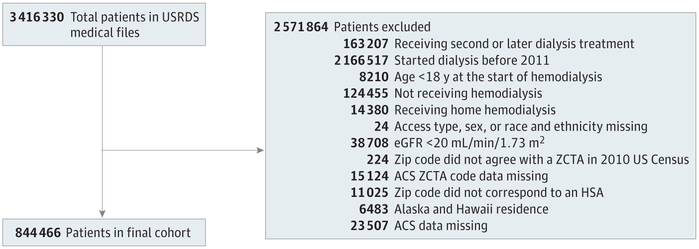
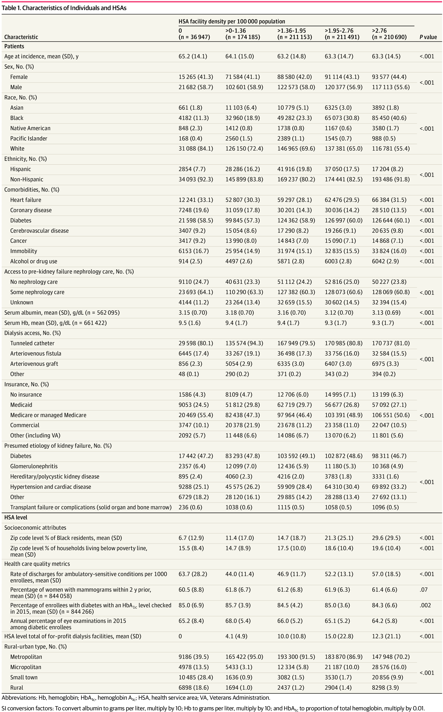
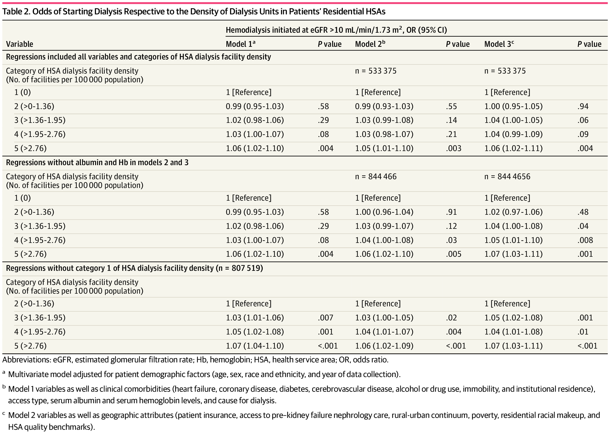
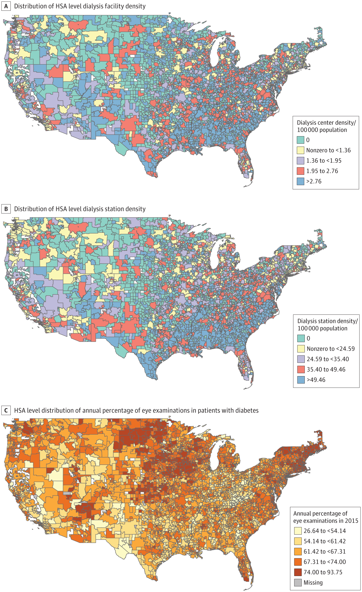

::: callout-important
## Reproduced from the published article
The figures and tables on this page are reproduced, unchanged, from Hemmige V, Deshpande P, Norris KC, Shen JI, Erickson KF, Johansen KL, Golestaneh L. Geographic dialysis facility density and early dialysis initiation. *JAMA Network Open*. 2024;7(1):e2350009 [@hemmige2024density], © 2024 Hemmige V et al., published under a [CC BY 4.0 license](https://creativecommons.org/licenses/by/4.0/). They are the images from the journal's figure slides. These are the outputs cleared by USRDS for publication; they were **not** produced by this repository's code. The replication's own outputs will appear only after they are checked and cleared. A text version of each table is in the [article's full text](https://doi.org/10.1001/jamanetworkopen.2023.50009).
:::

The [published supplement](supplement.qmd) has eTables 1 to 3 and eFigures 1 and 2. Apparent errors in the published figures and tables are kept as printed and listed under [Notes on the published results](#notes-on-the-published-results); several of them bear on choices in this replication.

## Figure 1. Diagram of study cohort

{fig-alt="Published cohort flow diagram. 3,416,330 total patients in USRDS medical files; 2,571,864 patients excluded: 163,207 receiving second or later dialysis treatment; 2,166,517 started dialysis before 2011; 8,210 age under 18 years at the start of hemodialysis; 124,455 not receiving hemodialysis; 14,380 receiving home hemodialysis; 24 access type, sex, or race and ethnicity missing; 38,708 eGFR <20 mL/min/1.73 m2; 224 ZIP code did not agree with a ZCTA in 2010 US Census; 15,124 ACS ZCTA code data missing; 11,025 ZIP code did not correspond to an HSA; 6,483 Alaska and Hawaii residence; 23,507 ACS data missing. 844,466 patients in final cohort."}

ACS indicates American Community Survey; eGFR, estimated glomerular filtration rate; HSA, health service area; USRDS, US Renal Data System; and ZCTA, zip code tabulation area.

## Table 1. Characteristics of individuals and HSAs

{fig-alt="Published Table 1: characteristics of 844,466 patients and their HSAs by HSA facility density per 100,000 population, in five columns: 0 (n = 36,947), >0-1.36 (n = 174,185), >1.36-1.95 (n = 211,153), >1.95-2.76 (n = 211,491) and >2.76 (n = 210,690), with P values. Rows cover age, sex, race, ethnicity, comorbidities, pre-kidney-failure nephrology care, serum albumin and hemoglobin, dialysis access, insurance, presumed etiology of kidney failure, ZIP code percentage of Black residents and of households in poverty, HSA health care quality metrics, HSA for-profit dialysis facilities, and rural-urban type. Mean age falls from 65.2 years in the 0 column to 63.3 in the >2.76 column; the percentage of Black patients rises from 11.3% to 40.6%."}

## Table 2. Odds of starting dialysis respective to the density of dialysis units in patients' residential HSAs

{fig-alt="Published Table 2: odds ratios (95% CI) for hemodialysis initiated at eGFR above 10 mL/min/1.73 m2 by category of HSA dialysis facility density, for Models 1, 2 and 3. With all variables (n = 533,375 in Models 2 and 3), category 5 (>2.76) versus category 1 (0): 1.06 (1.02-1.10), 1.05 (1.01-1.10) and 1.06 (1.02-1.11). Without albumin and hemoglobin (n = 844,466): 1.06 (1.02-1.10), 1.06 (1.02-1.10) and 1.07 (1.03-1.11). Without category 1 (n = 807,519), category 5 versus category 2: 1.07 (1.04-1.10), 1.06 (1.02-1.09) and 1.07 (1.03-1.11)."}

## Figure 2. Health Service Area (HSA) level findings

{fig-alt="Three published maps of HSAs in the contiguous United States. A: dialysis center density per 100,000 population in five categories (0; nonzero to <1.36; 1.36 to <1.95; 1.95 to 2.76; >2.76). B: dialysis station density per 100,000 in five categories (0; nonzero to <24.59; 24.59 to <35.40; 35.40 to 49.46; >49.46). C: annual percentage of eye examinations among patients with diabetes in 2015, in five categories from 26.64 to 93.75, with missing HSAs in gray. Dense HSAs in A and B are concentrated in the Midwest and Southeast."}

HSA-level dialysis facility density (A), HSA-level dialysis station density (B), and HSA-based annual percentage of eye examinations among patients with diabetes in 2015 (C).

## Notes on the published results

These are kept above as printed. Each is listed so that the replication's outputs can be compared with what was intended.

**Figure 1**

-   The 14,380 patients labelled "Receiving home hemodialysis" are those the original code removed for having a dialysis setting (`DIALSET`) other than codes 1 and 2. In the coding of the time (format `$MESET_CUR`), 1 was hospital inpatient, 2 dialysis facility and 3 home, so the box is right: home patients were removed. USRDS has since changed the coding, and the replication keeps in-center dialysis under the current coding; see the [differences page](differences.qmd#cohort-construction).
-   "38,708 eGFR <20 mL/min/1.73 m²" are patients excluded for an eGFR **above** 20 (or missing), as the original code describes. The paper's Methods say "less than 20"; the replication keeps the code's rule of 20 or below.
-   The 224 patients whose ZIP code "did not agree with a ZCTA" were counted by the original code but never removed by it; see the [differences page](differences.qmd).
-   No box shows exclusions for missing insurance or for a ZIP code with no RUCA code, although the original code applied both. The original code recorded the RUCA exclusion as removing 0 patients.
-   The counts add up: 3,416,330 − 2,571,864 = 844,466, and the 12 exclusion counts sum to 2,571,864.

**Table 1**

Each percentage was recomputed from its count and column size, and each group of rows was added up against its column size. Four percentages do not match their counts:

-   Tunneled catheter, >0-1.36 column: 135,574 is printed as 94.3%; 135,574 / 174,185 is 77.8%.
-   Commercial insurance, >0-1.36 column: 20,378 is printed as 21.9%; 20,378 / 174,185 is 11.7%.
-   Metropolitan, 0 column: 9,186 is printed as 39.5%; 9,186 / 36,947 is 24.9%.
-   Micropolitan, >2.76 column: 28,576 is printed as 16.0%; 28,576 / 210,690 is 13.6%.

Three groups of rows do not add up to their column size:

-   Rural-urban type, 0 column: the four rows sum to 31,547, against n = 36,947 (5,400 short).
-   Rural-urban type, >2.76 column: the rows sum to 205,678, against n = 210,690 (5,012 short).
-   Race, >2.76 column: the rows sum to 210,691, one more than n = 210,690. As a result, the White row sums to 558,365 across the columns, while eTable 1 gives 558,364.

The other group totals (sex, ethnicity, nephrology care, dialysis access, insurance and etiology) add up in every column. Seven other percentages differ from their counts by 0.05 to 0.1 points, which is consistent with rounding an already-rounded value. Men total 484,346, as in the abstract; the Results text gives 483,346.

**Table 2**

-   The Model 3 sample without albumin and hemoglobin is printed "n = 844 4656"; the Model 2 sample is 844,466.
-   Model 3, category 3, with albumin and hemoglobin: 1.04 (1.00-1.05) with P = .06.

## References

::: {#refs}
:::
