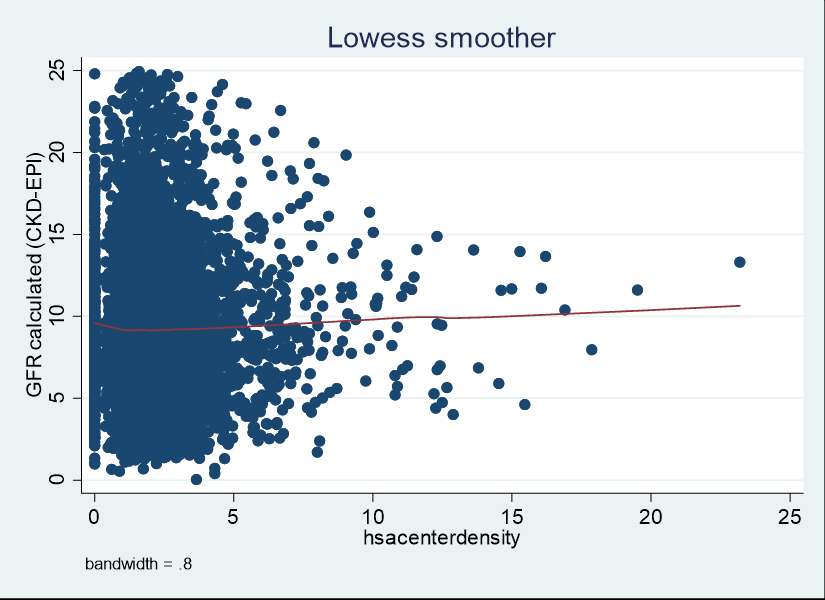
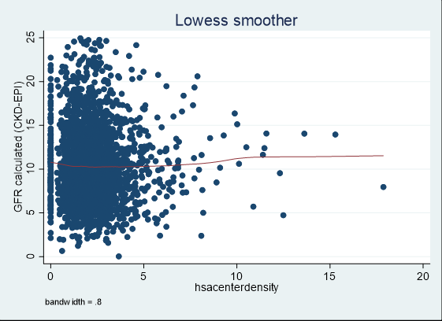

::: callout-important
## Reproduced from the published supplement
Everything on this page is reproduced, unchanged, from the Supplementary Online Content of Hemmige V, Deshpande P, Norris KC, et al. Geographic dialysis facility density and early dialysis initiation. *JAMA Network Open*. 2024;7(1):e2350009 [@hemmige2024density], © 2024 Hemmige V et al., published under a [CC BY 4.0 license](https://creativecommons.org/licenses/by/4.0/). These are the outputs cleared by USRDS for publication. They were **not** produced by this repository's code; the replication's own outputs will appear only after they are checked and cleared.
:::

The tables are transcribed cell for cell from the supplement PDF. Apparent typographical errors in the published tables are kept as printed and listed under [Notes on the published tables](#notes-on-the-published-tables).

## eTable 1. Regression modeling stratified by individual race

Column headings: **Model 1:** Multivariate model adjusted for patient demographic factors (age, sex and race/ethnicity and year of data collection). **Model 2:** Model 1+ clinical comorbidity, , access type, serum albumin and serum Hgb and dialysis cause. **Model 3:** Model 2 + geographic attributes (Patients insurance, access to pre-ESRD nephrology care, rural-urban continuum, poverty, residential racial makeup, HSA quality benchmarks).

**Regression of full model with Albumin and Hemoglobin, Black individuals only (n=146,386)**

| Odd of starting HD at GFR > 10 mL/min/1.73cm² (CI) | Model 1 | P value | Model 2 | P value | Model 3 | P value |
|---|---|---|---|---|---|---|
| Category of HSA facility density | N=236,947 | | | | | |
| 1 (0 facilities) | 1 | | 1 | | 1 | |
| 2(>0-1.36) | 1.03(0.94-1.14) | 0.5 | 1.12(0.99-1.26) | 0.07 | 1.04(0.91-1.18) | 0.6 |
| 3(1.36-1.95) | 1.04(0.95-1.15) | 0.4 | 1.12(1.0-1.26) | 0.06 | 1.06(0.93-1.19) | 0.4 |
| 4(1.05-2.76) | 1.06(0.97-1.17) | 0.2 | 1.12(0.99-1.26) | 0.06 | 1.07(0.96-1.20) | 0.3 |
| 5(>2.76) | 1.03(0.94-1.13) | 0.5 | 1.07(0.96-1.20) | 0.3 | 1.05(0.93-1.18) | 0.4 |

**Regression of full model without Albumin and Hemoglobin, White individuals only (n=355,564)**

| Odd of starting HD at GFR > 10 mL/min/1.73cm² (CI) | Model 1 | P value | Model 2 | P value | Model 3 | P value |
|---|---|---|---|---|---|---|
| Category of HSA facility density | N=558,364 | | | | | |
| 1 (0 facilities) | 1 | | 1 | | 1 | |
| 2(>0-1.36) | 0.97(0.93-1.01) | 0.2 | 0.96(0.91-1.01) | 0.1 | 1.01(0.96-1.05) | 0.8 |
| 3(1.36-1.95) | 1.02(0.98-1.06) | 0.4 | 1.02(0.99-1.07) | 0.3 | 1.06(1.01-1.10) | 0.02 |
| 4(1.05-2.76) | 1.03(0.99-1.07) | 0.1 | 1.02(0.98-1.07) | 0.4 | 1.05(1.00-1.10) | 0.03 |
| 5(>2.76) | 1.08(1.04-1.12) | <0.001 | 1.07(1.02-1.12) | 0.004 | 1.05(1.00-1.10) | 0.03 |

## eTable 2. Regression modeling for total population and stratified by individual race with exposure as continuous variable

Column headings as in eTable 1. In the published table, the Model 2 and Model 3 headings also give N=533,375.

| Odd of starting HD at GFR > 10 mL/min/1.73cm² (CI) | Model 1 | P value | Model 2 | P value | Model 3 | P value |
|---|---|---|---|---|---|---|
| For every 1 unit increase in HSA level dialysis facility density | 1.01(1.00-1.02) | 0.001 | 1.01(1.00-1.02) | 0.05 | 1.01(1.00-1.02) | 0.004 |

**Regressions without Albumin and Hemoglobin in Models 2 and 3 (n=844,467)**

| Odd of starting HD at GFR > 10 mL/min/1.73cm² (CI) | Model 1 | P value | Model 2 | P value | Model 3 | P value |
|---|---|---|---|---|---|---|
| For every 1 unit increase in HSA level dialysis facility density | 1.01(1.00-1.01) | 0.001 | 1.01(1.00-1.01) | 0.008 | 1.02(1.01-1.02) | <0.001 |

**Regressions with the full model and multiple imputation used for variables with missing data (Albumin and Hemoglobin); n=533,375**

| Odd of starting HD at GFR > 10 mL/min/1.73cm² (CI) | Model 1 | P value | Model 2 | P value | Model 3 | P value |
|---|---|---|---|---|---|---|
| For every 1 unit increase in HSA level dialysis facility density | 1.01(1.00-1.01) | 0.001 | 1.01(.00-1.01) | 0.04 | 1.01(1.00-1.02) | 0.004 |

**Regression of full model without Albumin and Hemoglobin, Black individuals only (n=235,947)**

| Odd of starting HD at GFR > 10 mL/min/1.73cm² (CI) | Model 1 | P value | Model 2 | P value | Model 3 | P value |
|---|---|---|---|---|---|---|
| For every 1 unit increase in HSA level dialysis facility density | 0.99(0.98-1.00) | 0.1 | 0.99(0.98-1.00) | 0.03 | 1.00(0.99-1.01) | 0.8 |

**Regression of full model without Albumin and Hemoglobin, White individuals only (n=558,364)**

| Odd of starting HD at GFR > 10 mL/min/1.73cm² (CI) | Model 1 | P value | Model 2 | P value | Model 3 | P value |
|---|---|---|---|---|---|---|
| For every 1 unit increase in HSA level dialysis facility density | 1.02(1.01-1.02) | <0.001 | 1.01(1.01-1.02) | <0.001 | 1.02(1.01-1.02) | <0.001 |

## eTable 3. Linear regression modeling where outcome variable is continuous

Column headings as in eTable 1; the first column is "Increase in eGFR at dialysis initiation".

**Regression of full model with albumin and hemoglobin (n=533,053)**

| Increase in eGFR at dialysis initiation | Model 1 | P value | Model 2 | P value | Model 3 | P value |
|---|---|---|---|---|---|---|
| Category of HSA facility density | N=866,467 | | | | | |
| 1 (0 facilities) | 1 | | 1 | | 1 | |
| 2(>0-1.36) | -0.02(-0.10-+0.05) | 0.5 | -0.08(-0.15-+0.006) | 0.7 | -0.02(-0.1-+0.07) | 0.7 |
| 3(1.36-1.95) | 0.4(-0.02-0.12) | 0.2 | 0.04(-0.04-0.13) | 0.3 | 0.07(-0.01-+0.15) | 0.07 |
| 4(1.05-2.76) | 0.08(0.01-0.15) | 0.02 | 0.04(-0.04-0.13) | 0.3 | 0.07(0.003-+0.15) | 0.06 |
| 5(>2.76) | 0.11(0.04-0.17) | 0.002 | 0.11(0.29-0.19) | 0.008 | 0.11(0.03-0.18) | 0.006 |

**Regressions with 0 facility HSAs eliminated ;( n=508,667)**

| Increase in eGFR at dialysis initiation | Model 1 | P value | Model 2 | P value | Model 3 | P value |
|---|---|---|---|---|---|---|
| Category of HSA facility density | N=807,519 | | | | | |
| 2(>0-1.36) | 1 | | 1 | | 1 | |
| 3(1.36-1.95) | 0.07(0.03-0.11) | 0.001 | 0.09(0.04-0.14) | <0.001 | 0.09(0.04-0.14) | <0.001 |
| 4(1.05-2.76) | 0.11(0.06-0.15) | <0.001 | 0.09(0.04-0.15) | 0.001 | 0.09(0.03-0.14) | 0.001 |
| 5(>2.76) | 0.14(0.08-0.19) | <0.001 | 0.13(0.06-0.19) | <0.001 | 0.13(0.06-0.19) | <0.001 |

## eFigure 1. Scatter plot of eGFR at dialysis initiation at the HSA level dialysis facility density in 1% random sample of the dataset

{fig-alt="Scatter plot from the published supplement, titled Lowess smoother. Each point is a patient in a 1% random sample; the x axis is HSA dialysis facility density per 100,000 (labelled hsacenterdensity, 0 to 25) and the y axis is eGFR calculated by CKD-EPI (0 to 25). Most points lie at densities below 5. A red lowess line (bandwidth 0.8) starts near 9.5, dips slightly to about 9, and rises slowly to about 10.5 at a density of 23."}

## eFigure 2. Scatter plot of eGFR at dialysis initiation in those diagnosed with heart failure at the HSA level dialysis facility density in 1% random sample of the dataset

{fig-alt="Scatter plot from the published supplement, titled Lowess smoother, for patients with heart failure in a 1% random sample. The x axis is HSA dialysis facility density per 100,000 (labelled hsacenterdensity, 0 to 20) and the y axis is eGFR calculated by CKD-EPI (0 to 25). Most points lie at densities below 5. A red lowess line (bandwidth 0.8) starts near 10.8, dips slightly to about 10.3, and rises to about 11.5 at a density of 18."}

## Notes on the published tables

These look like typographical errors in the published supplement. They are kept above as printed and are listed here so that the replication's tables can be compared with what the authors intended.

-   The fourth density category is printed as "4(1.05-2.76)"; the main text and Table 1 define it as >1.95 to 2.76.
-   eTable 1: the Black-only analysis gives n=146,386 in its heading and N=236,947 in the table; the White-only analysis, described as "without Albumin and Hemoglobin", gives n=355,564 and N=558,364.
-   eTable 2: the model without albumin and hemoglobin gives n=844,467; the main text gives 844,466. The Black-only n is 235,947 here and 236,947 in eTable 1. One interval is printed "1.01(.00-1.01)".
-   eTable 3: the reference categories are printed as "1"; for a linear model of eGFR the reference difference is 0. N=866,467 in the first panel. The category 3 Model 1 estimate is printed "0.4(-0.02-0.12)", outside its own interval; the category 5 Model 2 interval is printed "(0.29-0.19)". The category 2 Model 2 estimate, -0.08(-0.15-+0.006), has P=0.7.

## References

::: {#refs}
:::
